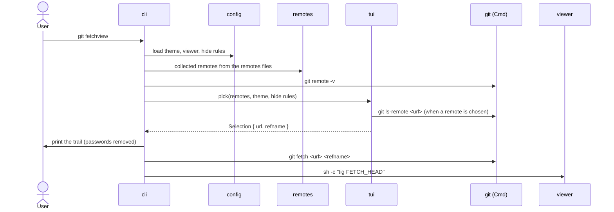
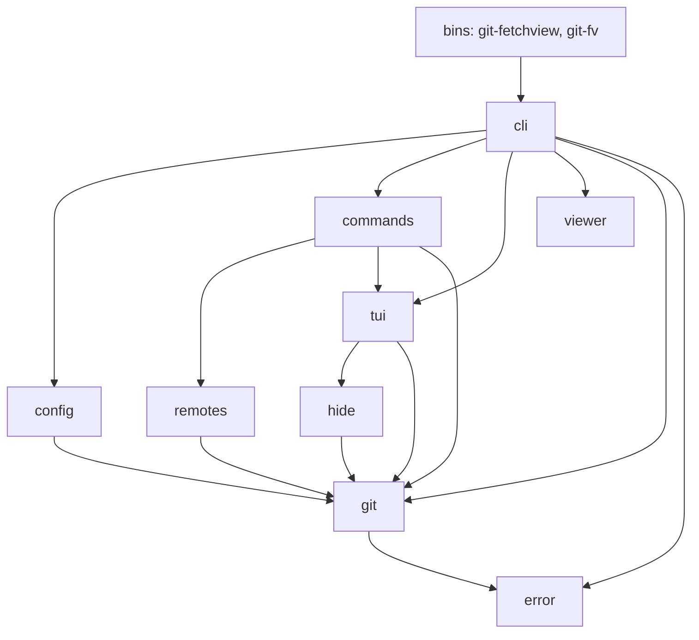
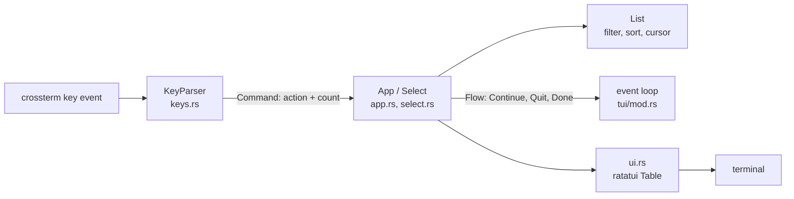
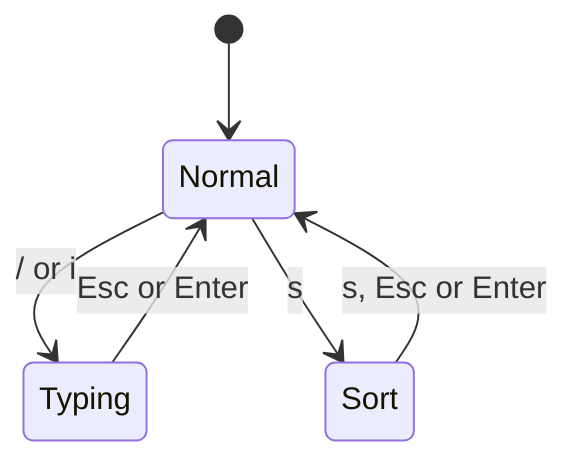
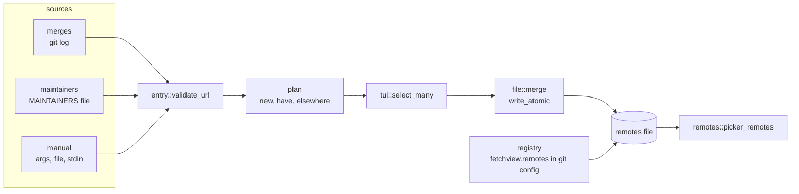
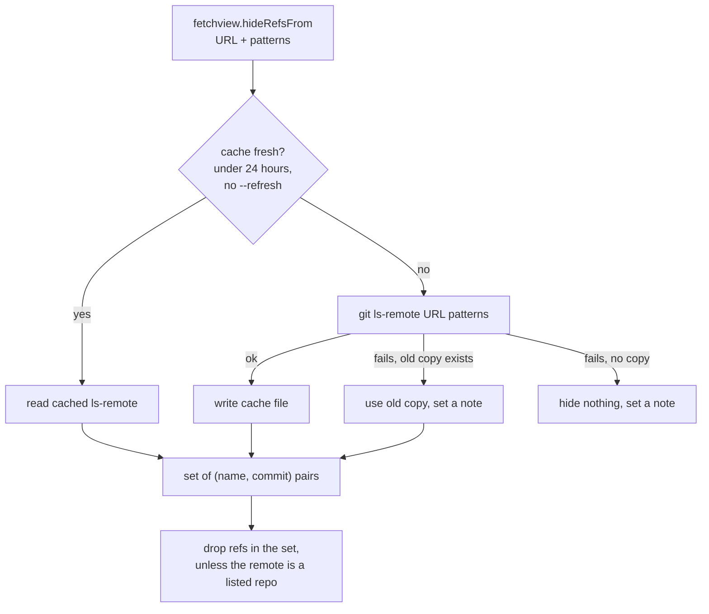

<!-- SPDX-License-Identifier: MIT -->
<!-- SPDX-FileCopyrightText: 2026 Tom Saeger <tom.saeger@gmail.com> -->

# Architecture

git-fetchview is a library with two thin binaries. `git-fetchview` and
`git-fv` both call `cli::main()`, and everything else lives in the
`git_fetchview` crate. `xtask` holds the project automation and `fuzz` holds
the fuzz targets; neither is shipped.

## The main flow

`git fetchview` with no subcommand runs `cli::pick_and_view`:

The `url` in the selection is the expanded URL, not the remote's name. That is
why the printed trail works on someone else's machine.

## Modules

| module | job |
|--------|-----|
| `cli` | `clap` arguments and the top-level flow |
| `commands` | `add`, `list` and `remove` |
| `config` | reads `fetchview.*` from `git config`; flag, then config, then default |
| `git` | every external call as a `Cmd`; parsing of `ls-remote` and `remote -v` output |
| `viewer` | viewer presets and resolving a preset name or a command |
| `hide` | the refs other trees already carry, and the cache of their `ls-remote` output |
| `remotes` | collected remotes: entries, the remotes file, sources, and the registry of files |
| `tui` | the pickers (see below) |
| `error` | the single `Error` enum |

## One rule: the trail cannot drift

Every external program runs through `git::Cmd`. Its `Display` output is
exactly what runs, and that is what gets printed as the trail. There is no
second place where the command line is built, so the printed commands cannot
differ from the executed ones. The one exception is password redaction: the
printed copy uses a redacted URL, and the run uses the real one.

## The picker

The picker is a state machine kept apart from the terminal. `tui/app.rs` and
`tui/select.rs` take actions and change state, and know nothing about the
screen. `tui/ui.rs` draws that state with `ratatui`. Tests drive the state
machine directly and render into a `TestBackend`.

- `keys.rs` is the only keymap. `KeyParser` turns key events into a
  `Command` (an `Action` and an optional count) and tracks pending input such
  as `5` or `g`. Change keys there.
- `App` is the two-level picker, remotes then refs. `Select` is the
  multi-select that `add` uses. Both share `List`.
- `List` owns the rows, the filter, the sort column and the cursor. Sorting
  never moves a row out of its group, and names compare naturally.
- Choosing a remote does not block. `App::step` returns `Flow::Load`, and the
  event loop in `tui/mod.rs` hands it to a worker thread that runs
  `ls-remote` and applies the hide rules, so the state machine stays free of
  I/O. The loop keeps redrawing a spinner and feeds the answer back with
  `App::finish_load`. Every request has an id, so the answer to a cancelled
  load is dropped. Cancelling sets a `git::Cancel` flag, and `Cmd::output_until`
  kills the git process when it sees it.

The mode decides how keys are read: normal, typing in the search box, or
choosing a sort column.

## Collected remotes

`remotes/` keeps parsers free of I/O so they can be fuzzed. Only `registry`
touches `git config` and the disk.

- A source implements `remotes::source::Source` and returns a `Scan` of
  validated, deduplicated entries.
- Every URL from a source or a remotes file goes through
  `entry::validate_url` before it is stored or handed to git. Only `https`,
  `http`, `git`, `ssh` and scp-style URLs pass, and transport helpers such as
  `ext::` are rejected.
- The remotes file holds `url<TAB>label<TAB>tags` lines. Comments are kept
  when the file is rewritten, and writes are atomic.
- `registry` finds the files named by `fetchview.remotes` at every config
  level and loads them.

## Hiding refs

`hide.rs` removes refs that a listed repository carries under the same name at
the same commit.

The cache lives in `<git-common-dir>/fetchview/hidden`, one file per rule. The
fetch is injected as a closure in the tests, so they need no network.

## Testing

- Unit tests sit next to the code. The picker state machines and the parsers
  are covered most heavily.
- `tests/` runs the built binary against throwaway repositories.
- `tests/pty.rs` runs the binary in a pseudo-terminal and reads the screen
  through a terminal emulator (`portable-pty` and `vt100`, dev dependencies).
  It covers picking, the trail left on screen, leaving the alternate screen,
  and cancelling a stalled load. It needs no network, and skips itself where no
  pty can be opened.
- `fuzz/` has a target for each parser: `ls-remote` output, `MAINTAINERS`,
  merge subjects, the remotes file, remotes lists and URL validation.
- `cargo xtask ci` runs all of it except fuzzing and Miri. See
  [development.md](development.md).
